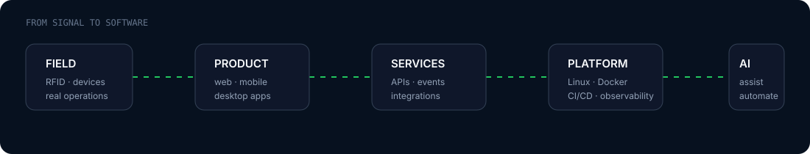
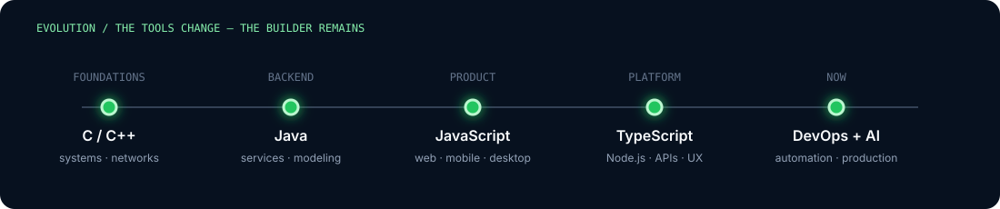
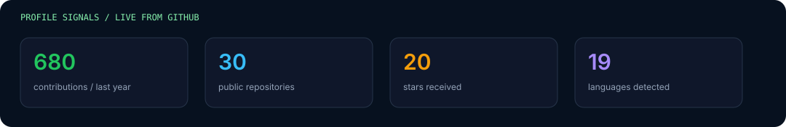

<div align="center">
  
</div>

<p align="center">
  <a href="https://github.com/brunosb"></a>
  
</p>

## Sobre mim

Sou **Bruno Silva Barbosa**, desenvolvedor e sócio da **Votu RFID**. Trabalho na interseção entre produto, software e infraestrutura: sistemas web, integrações RFID, automações, IA e operações em produção.

```text
Java / C / C++  →  JavaScript / TypeScript  →  Node.js  →  DevOps  →  IA
```

Hoje meu foco está em construir produtos confiáveis, reduzir trabalho operacional com automação e transformar problemas reais de negócio em software executável.

## O que estou construindo

<div align="center">
  
</div>

- **RFID e operações:** sistemas para varejo, inventário e rastreabilidade.
- **Backend e produto:** APIs, aplicações web/mobile/desktop e integrações.
- **Infraestrutura:** Linux, Docker, CI/CD, observabilidade e ambientes multi-tenant.
- **IA aplicada:** automações e recursos inteligentes incorporados a produtos reais.

## Projetos em destaque

| Projeto | O que é | Stack / contexto |
|---|---|---|
| [Tanzaku](https://github.com/brunosb/tanzaku) | Player MIDI de 36 teclas para performances | TypeScript |
| [LLRP-TS](https://github.com/brunosb/llrp-ts) | Driver para comunicação com leitores RFID via LLRP | Node.js · TypeScript · RFID |
| [RFdash](https://github.com/votu-rfid/rfdash) | Análise de divergência de inventário | Python · dados |
| [Stock Cash Flow](https://github.com/brunosb/stock-cash-flow-server) | Gestão de estoque e fluxo de caixa | Node.js · TypeScript |
| [LoTuS](https://github.com/lotus-tool/lotus-tool) | Modelagem gráfica de comportamento de software | Java · LTS |

## Minha evolução técnica

<div align="center">
  
</div>

## Stack

<div align="center">
  
</div>

## Atividade pública

<div align="center">
  
  
  
</div>

<div align="center">
  <sub>Dados gerados diretamente pela API do GitHub e atualizados automaticamente.</sub>
</div>

<br />

<div align="center">
  <a href="https://github.com/brunosb?tab=repositories">Explorar repositórios</a>
  ·
  <a href="https://github.com/brunosb/tanzaku">Ver projeto recente</a>
</div>
